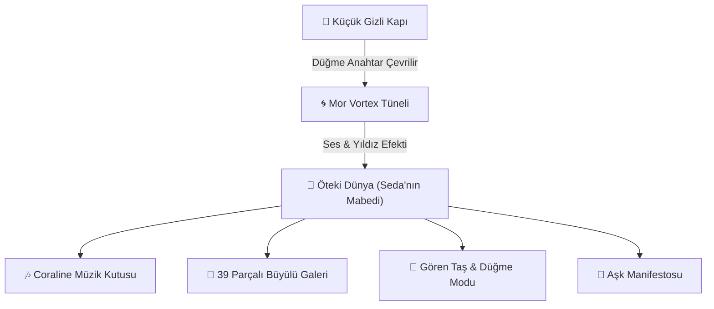

# 🗝️ Seda & Furkan: Coraline Evreninde Sonsuz Bir Aşk Hikayesi 🌌

<div align="center">

[](docs/SEDA_VE_FURKAN_ASK_MANIFESTOSU.md)
[](docs/SEDA_VE_FURKAN_ASK_MANIFESTOSU.md)
[](docs/LIVE_ACCESS.md)
[](docs/LIVE_ACCESS.md)

*“Bazen dünyada milyarlarca kapı vardır; fakat yalnızca tek bir tanesi seni gerçekten ait olduğun yere götürür...”*

[💌 Aşk Manifestosunu Oku](docs/SEDA_VE_FURKAN_ASK_MANIFESTOSU.md) • [🌐 Canlı Bağlantı Rehberi](docs/LIVE_ACCESS.md) • [✨ Özellikler](#-büyülü-özellikler)

</div>

---

## 🔮 Proje Hakkında

Bu proje, **Furkan'ın biricik aşkı Seda'ya** olan sevgisini ölümsüzleştirmek amacıyla, Neil Gaiman'ın ve Laika Stüdyosu'nun efsanevi başyapıtı **Coraline** evreninin gotik masalsı estetiğiyle nakış gibi işlenmiş özel bir web deneyimidir.

Site; Pembe Saray'ın gıcırdayan tahtalarını, kadife perdelerin ardındaki o gizli küçük kapıyı, siyah düğme anahtarı ve Seda ile Furkan'ın birlikte paylaştığı 39 unutulmaz gerçek anıyı tek bir kalpte buluşturur.

---

## ✨ Büyülü Özellikler

### 🚪 1. Küçük Gizli Kapı & Vortex Tüneli (Secret Door & Vortex)
- Ziyaretçiyi karşılayan antika ahşap kapı ve ucu düğme motifli siyah döküm anahtar.
- Anahtara dokunulduğunda kilit açılır, kapı gıcırdayarak aralanır ve mor ipek girdap tüneli ziyaretçiyi doğrudan "Öteki Dünyanın" kalbine taşır.

### 🎶 2. Coraline Müzik Kutusu (Pure Web Audio Synthesizer)
- Hiçbir harici ses dosyasına ihtiyaç duymaksızın doğrudan tarayıcının Web Audio API donanımıyla sentezlenen özel müzik kutusu.
- Coraline filminin ikonik *"Dreaming / Lullaby"* melodisini çalan, celesta ve çan tınılı, kalp atışı ritimli ambient ses motoru.

### 🔘 3. Düğme Göz & Gören Taş Modu (Seeing Stone Filter)
- Coraline'in hayalet çocukların gözlerini bulduğu yeşil üçgen delikli taş (`Seeing Stone`) efekti.
- Fotoğrafların üzerine gelindiğinde düğme göz ve antika masal filtreleriyle gizli mesajları ve anıların tarihini aydınlatma.

### 🌌 4. Yıldızlı Portal & Gece Ateşböcekleri (Canvas Particles)
- Gece mavisi gökyüzünde süzülen neon yeşili ve sarı ateşböcekleri.
- Fare veya dokunmatik ekran hareketleriyle arkasında yıldız tozu bırakan interaktif takımyıldızı motoru.

### 📸 5. Büyülü Anı Galerisi (39 Özel Hatıra)
- 25 Mart 2025'ten 12 Temmuz 2025'e uzanan tüm özel anılar kronolojik ve kategorize edilmiş olarak sunulur.
- Her fotoğrafa özel, Furkan'ın yüreğinden Seda'ya fısıldanmış Coraline temalı aşk notları.

---

## 🧭 Mimari ve Akış Şeması



---

## 🚀 Hızlı Başlangıç (Local & Canlı Erişim)

Detaylı ve resimli adım adım rehber için [docs/LIVE_ACCESS.md](docs/LIVE_ACCESS.md) dosyasına göz atın.

### 1. Yerel Olarak Çalıştırma
```powershell
cd "C:\Users\Lenovo\.gemini\antigravity\scratch\seda-furkan-love"
npx serve public -p 8080
```
Tarayıcınızda: `http://localhost:8080`

### 2. Seda'nın Telefonundan Anında Canlı Erişim (Localtunnel)
```powershell
npx localtunnel --port 8080 --subdomain seda-furkan-love
```
Seda'ya iletilecek link: **`https://seda-furkan-love.loca.lt`**

---

## 📁 Proje Dizin Yapısı

```text
seda-furkan-love/
├── docs/
│   ├── SEDA_VE_FURKAN_ASK_MANIFESTOSU.md  # Coraline konseptli aşk manifestosu
│   └── LIVE_ACCESS.md                     # Canlı yayın ve mobil kurulum rehberi
├── public/
│   ├── index.html                         # Ana Coraline deneyimi
│   ├── css/
│   │   ├── style.css                      # Gotik-romantik Coraline stilleri
│   │   └── portal.css                     # Kapı, tünel ve animasyon stilleri
│   ├── js/
│   │   ├── app.js                         # Ana orkestrasyon ve PWA kontrolleri
│   │   ├── audio.js                       # Web Audio sentezleyici (Müzik Kutusu)
│   │   ├── portal.js                      # Gizli kapı & geçiş mekaniği
│   │   ├── gallery.js                     # 37 anı ve modal yönetimi
│   │   └── stars.js                       # Canvas yıldız & ateşböceği motoru
│   ├── data/
│   │   └── memories.json                  # 37 fotoğraf ve Coraline aşk notları
│   └── images/                            # Seda ve Furkan'ın fotoğrafları
└── README.md                              # Ana dokümantasyon
```

---

## 🖤 İthaf

Bu proje; dünyanın neresinde, hangi boyutta ya da hangi zamanda olursa olsun, daima Seda'nın gözlerinde kaybolmayı seçen **Furkan** tarafından sonsuz aşkla tasarlanmıştır.

<div align="center">

*“Ömrümün en güzel gerçeği Seda'ma...”*  
**🗝️ 2025 — ∞ 🖤**

</div>
