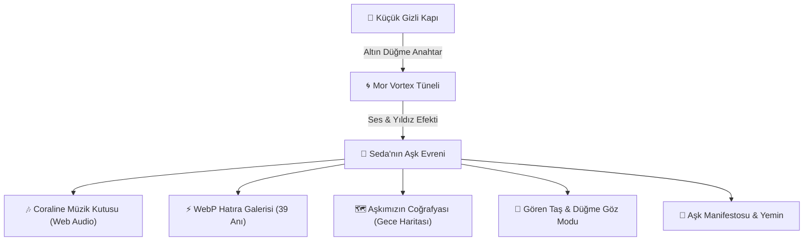

# 🗝️ Seda & Furkan: Coraline Evreninde Sonsuz Bir Aşk Hikayesi 🌌

<div align="center">

[](https://frkntlr.github.io/seda-furkan-love/)
[](docs/SEDA_VE_FURKAN_ASK_MANIFESTOSU.md)
[](docs/SEDA_VE_FURKAN_ASK_MANIFESTOSU.md)
[](docs/LIVE_ACCESS.md)

*“Bazen dünyada milyarlarca kapı vardır; fakat yalnızca tek bir tanesi seni gerçekten ait olduğun yere götürür...”*

[🌟 CANLI SİTEYE GİT](https://frkntlr.github.io/seda-furkan-love/) • [💌 Aşk Manifestosu](docs/SEDA_VE_FURKAN_ASK_MANIFESTOSU.md) • [🌐 Erişim Rehberi](docs/LIVE_ACCESS.md)

</div>

---

## 🔮 Proje Hakkında

Bu proje, **Furkan'ın biricik aşkı Seda'ya** olan sevgisini ölümsüzleştirmek amacıyla, Neil Gaiman'ın ve Laika Stüdyosu'nun gotik masalsı başyapıtı **Coraline** evreni konseptiyle nakış gibi işlenmiş özel bir web deneyimidir.

Pembe Saray'ın gıcırdayan ahşap kapısını, mor kadife girdap tünelini, ucu düğme motifli altın anahtarı ve İstanbul'un 39 farklı köşesinde yaşanmış gerçek aşk hatıralarını tek bir kalpte buluşturur.

---

## ✨ Büyülü Özellikler

### 🚪 1. Gizli Kapı & Mor Vortex Tüneli (Secret Door & Vortex)
- Ziyaretçiyi karşılayan antika ahşap kapı ve asılı duran altın düğme anahtar.
- Anahtara dokunulduğunda kilit açılır, kapı gıcırdayarak aralanır ve dönen mor ipek girdap tüneli ziyaretçiyi doğrudan "Öteki Dünyanın" kalbine taşır.

### 🗺️ 2. Aşkımızın Coğrafyası (Coraline Gece Haritası)
- İstanbul'un Kadıköy, Moda, Bebek, Galata, Kuzguncuk ve Adalar gibi anı duraklarını birbirine bağlayan interaktif gece rotası.
- Her durakta o anın gökyüzü koordinatları ve Coraline evrenine ait gizli fısıltılar yer alır.

### 🔮 3. Gören Taş Merceği & Düğme Gözler (Seeing Stone & Button Eyes)
- Coraline'in yeşil üçgen delikli taşından ilham alan `Seeing Stone` modu ile fotoğraflardaki gizli aşk fısıltıları açığa çıkar.
- Düğme göz modu ile dış dünyanın gürültüsüne kapanıp yalnızca birbirinin kalbine odaklanan özel aşk metaforu.

### ⚡ 4. Optimize WebP Mimarisi & Işık Hızında Yükleme
- 39 yüksek çözünürlüklü hatıra fotoğrafı, kalite kaybı olmaksızın hafifletilmiş modern WebP formatıyla desteklenir.
- Mobil cihazlarda ve zayıf internet bağlantılarında dahi sıfır bekleme süresiyle akıcı galeri deneyimi.

### 🎶 5. Coraline Müzik Kutusu (Web Audio Synthesizer)
- MP3 dosyası gerektirmeksizin tarayıcının Web Audio API donanımıyla üretilen otantik celesta ve çan tınılı Coraline ninni melodisi.
- Mobil Safari ve Chrome ile %100 uyumlu, dokunmayla uyanan akıllı ses motoru.

### 🌌 6. Yıldızlı Tuval & Gece Ateşböcekleri (Canvas Particles)
- Gece mavisi gökyüzünde süzülen neon yeşili ateşböcekleri ve fare/dokunma hareketlerini takip eden yıldız tozu efektleri.

---

## 🧭 Mimari ve Akış Şeması



---

## 🚀 Canlı Erişim Bağlantıları

Detaylı mobil kurulum adımları ve PWA kılavuzu için [docs/LIVE_ACCESS.md](docs/LIVE_ACCESS.md) dosyasına göz atın.

| Platform | Bağlantı Adresi | Özellik |
| :--- | :--- | :--- |
| 🌟 **GitHub Pages (7/24 Aktif)** | **[frkntlr.github.io/seda-furkan-love](https://frkntlr.github.io/seda-furkan-love/)** | **Kalıcı, Ücretsiz, Bilgisayar Açık Kalmadan 7/24** |
| ⚡ **Cloudflare Edge** | **[trycloudflare.com](https://valuation-disclaimers-returning-represent.trycloudflare.com)** | Şifresiz Doğrudan Tünel |
| 🌍 **Localtunnel** | **[seda-furkan-love.loca.lt](https://seda-furkan-love.loca.lt)** | Alternatif Web Tüneli |
| 💻 **Localhost** | `http://localhost:3000` | Yerel Geliştirici Sunucusu |

---

## 📁 Proje Dizin Yapısı

```text
seda-furkan-love/
├── docs/
│   ├── SEDA_VE_FURKAN_ASK_MANIFESTOSU.md  # Coraline konseptli aşk manifestosu & harita
│   └── LIVE_ACCESS.md                     # GitHub Pages ve 7/24 kesintisiz erişim kılavuzu
├── public/
│   ├── index.html                         # Ana Coraline deneyimi & semantik yapı
│   ├── css/
│   │   ├── coraline.css                   # Gotik-romantik Coraline stilleri
│   │   ├── portal.css                     # Kapı, anahtar & mor vortex animasyonları
│   │   └── modal.css                      # Fotoğraf büyütme ve aşk notu kartı
│   ├── js/
│   │   ├── app.js                         # Ana orkestrasyon & canlı sayaç
│   │   ├── audio.js                       # Saf Web Audio API sentezleyici (Müzik Kutusu)
│   │   ├── portal.js                      # Gizli kapı açılışı & vortex geçiş mekaniği
│   │   ├── gallery.js                     # 39 hatıra ve Polaroid render motoru
│   │   └── stars.js                       # Canvas yıldız & ateşböceği parçacık sistemi
│   ├── data/
│   │   └── memories.json                  # 39 fotoğrafın metadata ve aşk notları
│   └── images/                            # Seda ve Furkan'ın ölümsüz anıları
├── server.js                              # Express tabanlı yerel sunucu
└── README.md                              # Proje dokümantasyonu & mimari özet
```

---

## 🖤 İthaf

Bu eser; hangi evrende, hangi zamanda ya da hangi boyutta olursa olsun, daima Seda'nın gözlerinde kaybolmayı seçen **Furkan** tarafından sonsuz aşkla tasarlanmıştır.

<div align="center">

*“Ömrümün en güzel gerçeği Seda'ma...”*  
**🗝️ 2025 — ∞ 🖤**

</div>
